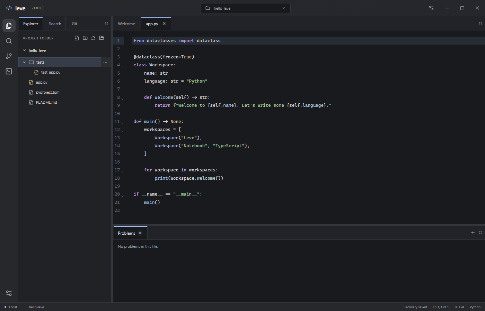

# Leve Editor

Leve is a Windows code editor with a dockable workspace, integrated terminals, and session recovery. Open a local project, arrange your panels, and pick up where you left off.

**[Download Leve 1.0.0 for Windows x64](https://github.com/flaviopiccolo-boop/leve/releases/download/v1.0.0/Leve_1.0.0_x64-setup.exe)** · [Release notes](https://github.com/flaviopiccolo-boop/leve/releases/tag/v1.0.0)



## Get started

1. Download and run the Windows x64 installer. The installer is unsigned and uses Microsoft Edge WebView2.
2. Launch Leve and select **Open folder** to open a project.
3. Press **Ctrl+P** to find a file, **Ctrl+Shift+F** to search across the project, and **Ctrl+S** to save your changes.

- **Make the workspace yours.** Drag tabs to dock or split panels, and switch between light and dark themes under **Settings → Appearance**.
- **Work with local projects.** Browse, create, rename, and delete files in Explorer. Use the title bar to switch between recent folders.
- **Use your tools alongside your code.** Open PowerShell, CMD, Git Bash, or PowerShell 7. Review staged, unstaged, and untracked files with inline Git diffs.
- **Get language feedback.** Enable autocomplete, diagnostics, and go to definition for Python, JavaScript, and TypeScript. ESLint support uses your project's configuration.
- **Resume your session.** Leve restores the last project, open files, unsaved edits, and panel layout.

[Language setup](#language-support) · [Windows benchmark](#windows-benchmark) · [Project roadmap](TODO.md) · [Contribute](CONTRIBUTING.md) · [MIT license](LICENSE)

## Try the browser preview

Requires Node.js 22.12+ or 24 and npm.

```powershell
npm install
npm run dev
```

Open http://127.0.0.1:1420. The web preview uses an in-memory demo project. You can edit files, save changes within the session, find files, dock panels, and resize areas. It does not access real folders or run shell commands. Reloading resets demo content while preserving the panel layout.

## Run from source on Windows

In addition to Node.js, install the [official Tauri prerequisites](https://v2.tauri.app/start/prerequisites/):

- Stable Rust with the MSVC toolchain (`rustc` and `cargo` on PATH).
- Microsoft C++ Build Tools with the Desktop development with C++ workload and Windows SDK.
- Microsoft Edge WebView2 Runtime.

```powershell
npm run desktop
```

## Integrated terminals

Click **+** and choose a shell to start a focused terminal session. Sessions use the project folder when one is open, or your home folder otherwise. Press Ctrl and the backtick key to start PowerShell directly. Leve opens with an empty terminal panel.

The terminal uses xterm.js in the frontend and portable-pty/ConPTY in Rust. Supported profiles are **PowerShell**, **CMD**, **Git Bash**, and **PowerShell 7**. The desktop app detects installed shells from PATH and common installation locations; unavailable profiles are disabled. Git Bash requires Git for Windows, and PowerShell 7 requires its separate installation. Reopen the picker to refresh detection. The web preview lets you try the picker and tabs without running commands or determining actual availability.

PowerShell starts without a profile and uses UTF-8 input/output. CMD disables AutoRun and switches to UTF-8. Git Bash runs as an interactive login shell and preserves the project directory. The frontend answers cursor-position queries during startup. Workspace paths are converted to a shell-compatible format when possible, so local batch files can retain the correct working directory. Terminal tabs are removed when loading a saved layout; new sessions are always created explicitly through **+** or the keyboard shortcut. Startup errors remain visible in the terminal tab instead of showing a Start button. Browser terminal tabs show an explicit preview message and cannot execute local commands.

Closing a terminal tab, resetting the layout, changing projects, or exiting the app ends the corresponding sessions. Processes that detach from a session may continue running.

Native Windows file drag-and-drop is disabled in the WebView to allow HTML panel dragging. Projects are opened through the folder picker.

## File management and project search

Use **New file** or **New folder** in the explorer header to create an entry at the project root. Right-click an entry, or use its **…** button, to rename or delete it. Folder menus also create files and subfolders inside that folder. New files open immediately; new folders and their parents are revealed in the tree.

With a file or folder focused in the Explorer, type the start of a name to jump to a visible entry. A repeated letter cycles through matches if it cannot extend the prefix. Press **Enter** to open a file or toggle a folder. Use **Ctrl+P** to find files inside collapsed folders. The file index scans up to 5,000 files and 15 directory levels and skips common dependency and build folders.

Renaming a file or folder updates affected open tabs and keeps unsaved edits and their disk baselines. The editor is recreated for a renamed path, so its undo history resets. Deleting an entry requires explicit confirmation, warns about affected unsaved buffers, permanently removes the disk entry, and closes affected tabs. Deletion does not use the Recycle Bin. Duplicate names never overwrite existing entries. Mutations reject paths outside the project, reserved Windows names, links/junctions, and changes to the project root. Folder deletion preflights up to 100,000 entries and 100 levels; larger or linked trees must be handled in Windows Explorer. Filesystem operations are not transactional against concurrent external filesystem changes; a failed recursive deletion may have removed some entries, so buffers are retained and the tree refreshes on error.

Press **Ctrl+Shift+F**, or choose **Search → Contents**, to search saved project files. **Match case** toggles case-sensitive matching. Results show path, line, column, and a text preview. Clicking opens the file and selects the match. If an open buffer has changed at that location, Leve keeps the buffer and asks you to save or reopen it and search again. **Search again** refreshes after disk changes. **Ctrl+P** continues to find file names and paths.

Native content searches run on a background worker and cancel when the query changes or the panel closes. Limits are 500 results, 5,000 files, 20,000 visited entries, 64 MB read, five seconds, 15 directory levels, and 1 MB per file. Reaching a budget produces an explicit partial-results notice. Binary, non-UTF-8, inaccessible, and linked entries are skipped. Common dependency and build folders are excluded (`.git`, `node_modules`, `target`, `.venv`, `venv`, `__pycache__`, `dist`, `build`, `.next`, `.idea`); `.gitignore` rules are not parsed. Searches use literal text of 1–256 characters on a single line. Save edits before searching. The browser demo supports file management and search in memory; these filesystem changes reset on reload.

## Language support

The Windows app supports autocomplete, live diagnostics, and go to definition for Python, TypeScript, and JavaScript. Install Node.js 24 or Node.js 22.22.2 or newer in the 22.x series, then install the servers from PowerShell.

```powershell
npm install -g pyright typescript@6 typescript-language-server
```

Restart Leve so it can see Node.js and the npm command directory on PATH. Open a project folder and enable the tools you want under **Settings → Language support**. Python, TypeScript, JavaScript, and ESLint have separate switches saved per project. Enable analysis for projects you trust, since project configuration and plugins can execute code. Missing tools are reported in the app. After installing a language server, reopen Leve or toggle its language off and on to retry.

- **Python and Django.** Pyright reads `pyrightconfig.json` or `[tool.pyright]` in `pyproject.toml`. Leve detects `.venv` or `venv` at the project root. Install Django and the project's dependencies in that environment, or configure another environment in Pyright.
- **TypeScript and JavaScript.** One TypeScript Language Server handles both languages, including TSX and JSX. It uses the project's `tsconfig.json` or `jsconfig.json`. Use `checkJs` or `// @ts-check` for JavaScript type errors.
- **ESLint.** Install ESLint and its plugins or TypeScript parser in the project and configure its rules. Leve uses the nearest project ESLint installation to check the active JavaScript or TypeScript file, including unsaved text. Analysis starts after a 750 ms pause and checks one file at a time per project.

Press **Ctrl+Space** for completion or **F12** to open a definition inside the workspace. The **Problems** tab next to the terminal shows the active file's diagnostics and their count. Click a result to jump to the line, expand it to view the details, or copy one result or the whole file group as JSON. Press **Ctrl+Shift+M** to reveal the panel. The language servers start when a supported document opens and stop when their languages are disabled or the workspace changes. Browser preview supports editing without the native analysis processes.

The desktop title bar is part of Leve's interface and follows its theme. Drag the empty area to move the window or double-click it to maximize or restore. Closing from the title bar uses the session recovery flow.

## Git changes

With Git for Windows installed, open a repository folder in the desktop app and select **Git changes** in the activity bar. The panel groups files by staged changes, working tree changes, and untracked files. Click a file to see its unified diff in a read-only tab. A file with both staged and unstaged edits appears in both groups. Renames appear as a deletion and an addition.

The staged diff compares the index to the last commit. The working tree diff compares saved content to the index, and untracked files are shown as additions. Save edits before inspecting their diff. The panel and Explorer update after a save or file operation in Leve. Use **Refresh Git changes** after running Git commands in the integrated terminal.

Leve checks the open folder and its immediate subfolders for repositories, skipping `node_modules`. You can open a parent folder and see changes in a repository such as `app/`. If the repository starts above the open folder, Leve lists only the changes within that folder. If no repository is found, the panel shows how to initialize one with `git init`.

The Explorer colors changed file names and shows status badges. Folders with changed descendants are marked as well. The colors follow the [default Git palette in VS Code](https://github.com/microsoft/vscode/blob/main/extensions/git/package.json#L4159-L4248) for the corresponding light or dark theme.

Git describes binary changes in the patch header. The viewer supports patches up to 256 KiB, and untracked files up to 4 MB.

## Session recovery

The desktop app checkpoints the current session to its local application data directory, under `recovery/session.json`, roughly every 400 ms while state changes. A normal window close waits for the latest checkpoint. Files in the project are written only when you explicitly save them.

Recovery snapshots are written atomically. A previous valid snapshot is kept in `session.previous.json` and used if the current snapshot cannot be read. The browser preview uses local storage instead of the native recovery files.

On startup, the last project, open file tabs, active file, and docking layout are restored. Unmodified files are read again from disk. Unsaved buffers retain their original disk baseline, so external edits are detected before saving; if the recovered text already matches the disk, it is treated as saved. Missing project folders keep the recovered buffers available with a **Retry recovery** action. Invalid recovery data is preserved until the user explicitly starts a new session.

The status bar shows **Recovery pending**, **Recovery saved**, or **Recovery unavailable**. Write failures display an error and a retry action. A sudden failure can lose edits made since the last completed checkpoint. Native snapshots support up to 100 files, 4 MB per file, and 32 MB total including the saved baselines and layout. Browser storage limits depend on the browser. Undo history and cursor positions are not restored across restarts, and multiple app instances do not coordinate their recovery snapshots.

## Current limitations

- Automated tests cover the web interface and backend operations. Rust tests include a real PowerShell/ConPTY session with UTF-8 output and a batch file running in a folder with spaces and non-ASCII characters. The complete desktop UI flow still requires manual validation.
- UTF-8 text files up to 4 MB. Editing may normalize line endings to LF. Binary files are rejected.
- No debugging, extensions, or automatic updates. Go to Definition is limited to files inside the open workspace.
- Project content search covers saved files with the documented exclusions and limits. Use Ctrl+F to search the active buffer, including unsaved edits.
- No automatic filesystem watching. Refresh the tree manually. A save conflict requires copying your changes and reopening the file.
- Recovery restores the most recent completed checkpoint; it is not a substitute for saving project files or version control.
- Conflict detection is not a transactional lock against another process writing at the same instant.
- Real folders and shells are available only in the desktop app. There is a limit of 16 simultaneous terminal sessions and no automatic reconnection or restart after a shell exits.

## Validate changes

```powershell
npm run build
npm test
```

The browser tests use the installed Google Chrome by default. Set `LEVE_TEST_BROWSER` to another Playwright channel, such as `msedge`, to override it. Tests cover the editor, layouts, themes, terminal creation, file-management dialogs and buffer updates, project-search navigation and cancellation, and recovery after interruption, external edits, unavailable projects, and invalid snapshots. Native tests cover real filesystem mutations, collision and traversal protection, junction rejection, Unicode search positions, search budgets/exclusions, recovery, and real PTY sessions. Screenshots are written to `artifacts/`.

With Rust configured:

```powershell
cargo test --manifest-path src-tauri/Cargo.toml
npm run desktop
```

For manual desktop validation: open a real folder; edit, save, and reopen a file; reject an overwrite after an external edit; close a dirty tab; run commands with non-ASCII output; run a local batch file; resize a terminal; interrupt a command with Ctrl+C; and confirm terminal sessions close with their tabs or window.

To build a development executable with the interface embedded, without an installer or web server:

```powershell
npm run desktop:build:dev
```

The output is `src-tauri/target/debug/leve-editor.exe`. This build is not optimized and should not be used to evaluate final resource usage or performance. After installing Rust, open a new terminal so PATH includes Cargo. Close the running editor before replacing its executable.

## Build an installer

```powershell
npm run desktop:build
```

On Windows x64, this produces `src-tauri/target/release/bundle/nsis/Leve_1.0.0_x64-setup.exe`. The first build downloads the NSIS tools. The installer runs per user and can download the WebView2 bootstrapper when the runtime is missing.

The unsigned 1.0.0 package was validated in silent mode on a machine with WebView2 already present. Installation in a custom directory registered Leve in Windows. The installed app opened a project, edited and saved a real file, and restored the project and file on restart. Uninstallation removed the binaries and the Windows uninstall registration.

## Windows benchmark

Close all running Leve windows, then point the benchmark at the installed or standalone release executable.

```powershell
node scripts/benchmark-windows.mjs 'C:\path\to\leve-editor.exe' 5
```

The script creates synthetic workspaces of 100 and 4,000 files and uses a separate WebView2 profile. It temporarily moves any existing recovery directory to a sibling backup, prints its path, and restores it on normal completion or a handled failure. If the benchmark is forcibly interrupted, close the benchmark instance and restore that backup before reopening Leve. Raw samples are written to `artifacts/windows-benchmark-*/results.json`.

Startup runs from process launch until Playwright observes the local status bar, including the WebView2 debugger connection. It uses a warmed WebView2 profile and an empty Leve session. Project timings use the recent-project menu. Search timings include the 250 ms debounce and end when the result appears or the scan completes. Both workspaces include the same 60,000-line plain text file for the open, edit, and save measurements. Project content search skips that file because it exceeds the 1 MiB per-file search limit. The benchmark runs without language servers or terminals.

Memory samples sum Leve and its WebView2 child processes after two seconds idle and again after opening the large file. Private bytes measure committed private memory. The summed working set measures resident pages and can count a shared page more than once.

The 1.0.0 installed build was measured on Windows build 26300 with an Intel Core i7-10700, 31.7 GiB RAM, and WebView2 156.0.4314.58. Across ten empty-session launches, median startup was **1,070 ms** (919–1,222 ms). Median idle memory was **163 MiB private** and **386 MiB summed working set**.

| Operation or memory sample | 100 files | 4,000 files |
| --- | ---: | ---: |
| Open project and render root entries | 133 ms | 174 ms |
| Find a file by name on first search | 329 ms | 1,349 ms |
| Search project contents | 381 ms | 2,426 ms |
| Open a 2.92 MiB text file | 888 ms | 1,318 ms |
| Insert text at the start of the file | 39 ms | 67 ms |
| Save and verify the edit on disk | 814 ms | 866 ms |
| Private memory with the file open | 223 MiB | 253 MiB |
| Summed working set with the file open | 459 MiB | 486 MiB |

Each column shows the median of five runs. Content search found the expected match in every run and completed without reaching the search budget. It had the largest increase between the two project sizes.

## Project structure

Leve uses Tauri 2 and Rust for native operations, React and TypeScript for the interface, CodeMirror 6 for editing, and FlexLayout for docking.

- `src/App.tsx`: application shell, docking, navigation, and file state.
- `src/Editor.tsx`: CodeMirror integration and language loading.
- `src/Explorer.tsx`: file tree, entry menus, and mutation dialogs.
- `src/ContentSearch.tsx`: cancellable project content search UI.
- `src/Terminal.tsx`: terminal frontend and Rust communication.
- `src/shells.ts`: terminal profile types and preview data.
- `src/workspace.ts`: workspace access and browser demo.
- `src/session.ts`: session checkpoint coordination and file reconciliation during recovery.
- `src-tauri/src/main.rs`: local operations, saving, and PTY sessions.
- `src-tauri/src/shells.rs`: installed-shell discovery and launch configuration.
- `src-tauri/src/session.rs`: bounded, atomic recovery snapshots and fallback storage.
- `src-tauri/src/files.rs`: scoped create, rename, and permanent-delete operations.
- `src-tauri/src/search.rs`: bounded background content search.
- `tests/editor.spec.ts`: browser integration tests.

See the [product roadmap and to-do list](TODO.md) for the six recommended priorities and their completion status.
